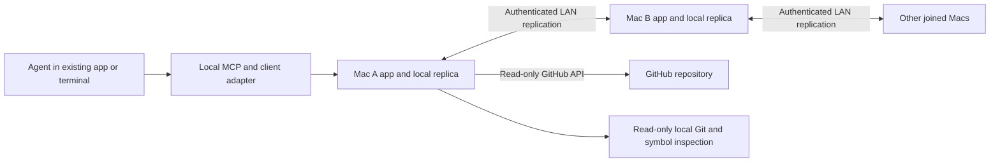

# LAN Agent Workspace — proposed v1 plan

Status: approved by the user on October 20, 2026. Phase 1 implementation is authorized and in progress.

This is a new project in an initially empty folder. The plan was prepared and reviewed before any implementation began.

User-confirmed requirements are identified below. Architecture, screen layout, lifecycle details, and release sequencing are proposals for approval rather than assumptions about decisions the user has already made.

## 1. Product and confirmed scope

A minimal macOS app coordinates coding agents working on the same GitHub repository across 2–10 Macs on a LAN. Each computer keeps its own local clone and separate work branch based on main. Git remains responsible for exchanging code; the LAN workspace shares plans, task intent, reservations, and activity.

- One repository per workspace, including public and private GitHub repositories.
- Apple Silicon arm64 target across M-series models. Support matrix: macOS Sequoia 15, Tahoe 26, and macOS 27. Compatibility depends on the OS/runtime and actual tests, not a chip-name allowlist or a promise about untested future hardware. [Apple version list](https://support.apple.com/en-us/109033)
- Codex, Cursor, OpenCode, and Claude Code remain in users' existing apps or terminals. This app coordinates them rather than launching them.
- One shared password, equal participant access, no administrator tier.
- Either a person or an agent can create the shared project plan.
- Before work, the user tells their agent to read the shared plan and document what it intends to do. Proposals include a good task description and function-level additions/changes, without requiring exact edit lines.
- Different functions in one file may be worked on concurrently if the scopes do not overlap. Unreliable function parsing means reserving the whole file.
- Overlapping plans pause both affected tasks and notify their users. Each user decides whether to abandon the task or ask the agent to revise its approach.
- Hosting moves between Macs. Every joined Mac keeps plans/history locally. Uncertain coordination blocks new tasks; existing tasks may continue within their reserved scope. Additional functions require another coordinated check.
- GitHub is observational: show branches, PRs, checks, and relevant status without creating branches, opening PRs, committing, pushing, or merging.
- Minimal styling inspired by Claude Code, plus both a branch/commit graph and a file/function activity tree.

## 2. Proposed everyday workflow

1. A person creates a workspace, selects an existing local clone and GitHub repository, and sets its join password. Other Macs discover it on the LAN, join, and associate their own local clone. A manual address provides a discovery fallback.
2. Agent setup exposes the coordination tools and supplies concise project instructions. Existing instructions/configuration are preserved, with a preview of additions and a way to remove this integration.
3. The user prompts their agent to read the current shared plan and active work before proposing a task.
4. The agent submits its branch/base commit, task description, intended files, qualified functions/symbols to add/change/remove, and relevant shared interfaces/dependencies.
5. The coordinator checks that the plan revision is current and registers the task atomically. The agent starts only after a committed acceptance, not merely after submitting a request.
6. If scopes overlap, the new task cannot start; both affected tasks become blocked and receive a pause reason. Users see the exact overlapping scope and decide how to revise or cancel their work.
7. Scope changes are submitted before editing additional functions/files. A revised plan is checked again against the current shared state.
8. The agent reports that editing is complete and links its PR when available. The app shows actual Git/GitHub changes alongside the planned scope.

Proposed reservation lifetime: finishing edits does not immediately release the scope while its changes are still in an open PR. Release requires the owner's acknowledgement that writing has stopped and either a linked PR merge or an explicit abandon decision. Observing a merge alone cannot release an active/offline task. Closing an unmerged PR requires an explicit abandon/revise decision. This proposal prevents unfinished integration work from disappearing from coordination.

Proposed revisions/cancellation: keep the old reservation until the owner acknowledges that any admitted/background writes using the old scope have stopped. Then commit the release/replacement and check the revised scope. A stale receipt, heartbeat loss, or another participant's cancel request cannot silently free a scope still being edited.

## 3. Proposed screens and visual design

Use restrained typography, neutral colors, compact panels, strong keyboard navigation, and color plus text for state. Avoid chat transcripts as the primary interface.

| Screen | Purpose and contents |
| --- | --- |
| Create / Join | Saved workspaces, LAN discovery, password entry, local clone selection, GitHub connection, and agent setup status. |
| Workspace | Shared plan, task list, connected/offline Macs, current host, approval availability, and recent activity. |
| Worktree | Branch/commit graph and expandable files/functions, overlaid with task owners, intended changes, and conflicts. |
| Task / Conflict | Task description, exact declared scope, plan revision, branch/base commit, reservations, conflict reason, and revise/cancel controls. |
| GitHub | Read-only PRs, branches, checks, changed files, and links to GitHub; show refresh time and unavailable/unknown states. |
| Connections | Supported-agent setup checks, notification settings, local clone mapping, peer state, and safe workspace leave. |

The branch graph distinguishes observed commits from planned work. Planned functions do not appear as real commits. Remote uncommitted activity is limited to metadata reported by that Mac; the UI does not imply it can inspect a disconnected computer's files. Stale observations remain visibly stale.

Proposed notifications: in-app conflict details and macOS notifications for affected users, plus a clear reason returned through each agent's next coordination/hook response. Track `pause requested`, `acknowledged stopped`, and `unreachable` separately. Native notification behavior is a packaging/verification requirement. [Electron notifications](https://www.electronjs.org/docs/latest/tutorial/notifications)

## 4. Proposed architecture

| Component | Choice and reason |
| --- | --- |
| Desktop UI | Electron, React, and TypeScript, matching the project's JavaScript/TypeScript preferences. Renderer isolation and a narrow IPC boundary keep filesystem/network capabilities outside UI components. [Electron](https://www.electronjs.org/docs/latest/) |
| Local integration | A TypeScript MCP bridge and client-specific hooks/plugins on each Mac. They connect existing agent sessions to the local app and provide task/status tools. |
| Durable coordination | A small bundled native Go helper using HashiCorp Raft, a bbolt-backed durable log/store, and file snapshots. Use an established consensus library instead of writing an election algorithm. [Raft](https://github.com/hashicorp/raft), [durable backend](https://github.com/hashicorp/raft-boltdb/blob/master/v2/go.mod) |
| Local projections | Rebuildable local indexes/cache for the UI, code-symbol index, and GitHub observations. Authoritative task decisions come from committed replicated state, not a cache. |
| Code inspection | Tree-sitter adapters with explicit language fixtures, plus whole-file fallback. Git inspection runs read-only against each local clone. |
| Discovery and transport | Bonjour discovery with manual-address fallback; authenticated encrypted LAN connections and stable workspace/device identities. [Bonjour operations](https://developer.apple.com/library/archive/documentation/Cocoa/Conceptual/NetServices/Articles/NetServicesArchitecture.html) |
| Tests and packaging | Vitest for TypeScript behavior, Go tests for the coordination helper, integration/failure tests, and an arm64 macOS app bundle/DMG. |

The native helper is the proposed exception to the preferred TypeScript stack: it isolates durable consensus in an established library while UI, schemas, and agent adapters stay TypeScript. Users should not need to install Go, Node, or a database to run the packaged app.

Proposed data records: workspace identity and repository identity; committed membership; versioned shared plan; device and agent-session identity; task revision and branch/base commit; file/symbol reservations; conflict decisions and acknowledgements; completion/PR links; ordered activity history. Retryable mutations carry stable request IDs to prevent duplicate tasks after a lost response. A deduplicated historical acceptance is not fresh permission: the adapter must validate the current task revision/state before resuming work. Persist owner stop acknowledgements locally before submitting a release; restored sessions/receipts require revalidation rather than reviving an old acceptance.

Do not replicate repository files or GitHub credentials as workspace history. Share the minimum task/symbol/branch metadata needed for coordination. Workspace documentation/history should be exportable as Markdown/JSON without the app committing those files automatically.

## 5. Host replacement, offline work, and persistence

Proposed initial policy: each fully synchronized joined Mac is an equal eligible voting member. Presence and voting membership are separate. Membership changes themselves must be committed safely; a heartbeat timeout cannot independently redefine who has authority. [Membership rules](https://etcd.io/docs/v3.7/op-guide/runtime-configuration/)

| Configured voting Macs | Votes needed to approve new work | Abrupt failures tolerated |
| --- | --- | --- |
| 2 | 2 | 0 |
| 3 | 2 | 1 |
| 4 | 3 | 1 |
| 5 | 3 | 2 |
| 10 | 6 | 4 |

The counts follow majority-based consensus. [Quorum counts](https://etcd.io/docs/v3.7/faq/#what-is-failure-tolerance)

- With enough connected voters, elect another host automatically and briefly hold new requests while authority changes.
- Without enough voters, hold new tasks, scope expansions, shared-plan changes, and reservation releases. Saved plans/history remain viewable; local drafts remain drafts.
- Already accepted tasks may continue offline within their last accepted scope, as requested. Keep their reservations indefinitely until an authoritative, valid completion/cancellation is recorded; do not release them because a Mac sleeps.
- If an offline task finishes, record a local pending completion and synchronize it later. Another participant cannot silently reclaim that task's reserved scope while its owner may still be editing.
- A conflict affecting an unreachable agent remains `pause pending`; the competing task stays blocked. Deliver the pause on reconnection. No UI claim that the offline agent has already stopped.
- On rejoin, catch up with committed membership, plans, and task decisions before approving anything new. A joining peer synchronizes before becoming eligible to host.
- A clean exit attempts a committed handoff/membership update. Sudden sleep or crashes may prevent it. Leadership transfer alone does not remove the majority requirement.
- After all Macs close, any previous participant can reopen its saved workspace. Approval authority still follows the saved committed membership: a lone stale replica cannot automatically create a replacement authoritative cluster. If enough prior voters return, normal coordination resumes. A safely reduced one-voter configuration can resume under its own committed configuration.

Proposed v1 recovery boundary: normal restart/rejoin is automatic; loss of the required replicas does not trigger an unsafe reset. A deliberate disaster-recovery flow is separate work requiring a reviewed design, not a hidden fallback. [Raft recovery API](https://pkg.go.dev/github.com/hashicorp/raft#RecoverCluster)

## 6. Conflict detection and language coverage

The coordinator evaluates a proposal against the current plan revision, accepted task reservations, pending blocked scopes, and linked open-PR work. Serialize checking and reservation creation in one state-machine operation so concurrent submissions cannot both pass using stale state.

Normalize repository-relative paths and qualified symbol identities against the declared base commit; handle case, aliases, renames, and divergent branch bases conservatively. Do not compare raw line offsets from different clones. A shared-plan edit does not silently release or rewrite existing task scopes.

| Situation | Proposed result |
| --- | --- |
| Same qualified function/symbol, or one scope contains the other | Block both affected tasks and request a user resolution. |
| Different independently scoped functions in one parsed file | Allow if neither requires a conflicting shared interface or file-wide change. |
| Whole-file reservation versus any work in that file | Conflict. |
| Adding the same function/name or creating the same file | Conflict, even though the symbol/file does not exist yet. |
| File rename/delete, parser failure, unsupported language, ambiguous top-level change | Treat affected paths as whole-file scopes; apply directory scope where the declared operation requires it. |
| Signature, shared type/schema, export/import, dependency manifest, lockfile, or generated shared output | Include the relevant shared symbol/file in the declared scope and use conservative conflict rules. |
| Actual edits exceed accepted scope | Flag drift and pause subsequent supported actions pending a coordinated revision. |

Proposed first parser matrix: JavaScript/JSX, TypeScript/TSX, Python, Go, Rust, Java, C, C++, C#, Ruby, PHP, Swift, and Kotlin. A language counts as function-level supported only after its adapter passes fixtures for qualified names, methods, nested functions, additions, deletions, renames, and parse errors. Every other file remains usable through whole-file reservations. Adding grammars alone is not enough to claim reliable function detection. [Tree-sitter](https://tree-sitter.github.io/tree-sitter/), [grammar-specific queries](https://tree-sitter.github.io/tree-sitter/using-parsers/queries/1-syntax.html)

Agents review the shared plan using their existing model. The app's initial overlap decisions are explainable symbol/path/dependency checks; no additional hosted model or paid AI API is proposed. Different function names alone cannot prove semantic independence. Show exactly what was checked and require declared shared interfaces/dependencies. Do not advertise a guarantee of conflict-free merges.

## 7. Agent connections and stopping behavior

Proposed common MCP tools: read plan and current work; submit/revise task; check task status; acknowledge pause; report completion; cancel an owned task; link a PR. Tool names are implementation details to finalize in the API contract.

| Agent | Proposed adapter |
| --- | --- |
| Codex | MCP connection, project instructions, and trusted pre-tool hooks for supported local tools. [MCP](https://learn.chatgpt.com/docs/extend/mcp?surface=cli), [hooks](https://learn.chatgpt.com/docs/hooks) |
| Cursor | MCP connection, project rules, and IDE Agent pre-tool hooks. Test any CLI mode separately before claiming it supported. [MCP](https://cursor.com/docs/mcp), [hooks](https://cursor.com/docs/hooks) |
| Claude Code | MCP connection, compatible project instructions, and pre-tool hooks with failure-blocking behavior on a verified supported version. [MCP](https://code.claude.com/docs/en/mcp), [hooks](https://code.claude.com/docs/en/hooks) |
| OpenCode | MCP connection, project instructions, and a local plugin guarding tool execution. [MCP](https://opencode.ai/docs/mcp-servers/), [plugins](https://opencode.ai/docs/plugins/) |

Each adapter checks whether the session has accepted work before starting a new task and whether the task has become blocked before supported future actions. Native edit/patch tools provide scope metadata where available. Shell commands and third-party tools require conservative handling and post-change scope auditing; arbitrary shell writes cannot be assumed to be fully understood in advance.

Blocking tools must leave coordination/read/revise/cancel actions available so an agent can explain the problem and help its user resolve it. Avoid repeated denial loops; show the human action needed.

Enforcement boundary: these are integrations with independent user-run agents, not an OS filesystem lock. MCP/instructions alone do not enforce a stop. A native gate can refuse the next covered action, but a command already admitted may finish. Unsupported paths, disabled hooks, and disconnected sessions cannot be represented as confirmed stopped. Validate actual client versions and coverage before declaring support, and expose setup/health failures in the app.

## 8. Password, GitHub, and data handling proposals

- Use a standard authenticated TLS/pairing design with pinned device/workspace identities; no plaintext password transport or homemade cryptographic protocol. Verify first-contact trust and host changes in the feasibility phase before selecting exact libraries.
- The shared password controls workspace joining and equal app permissions. It does not grant GitHub account rights. Store local device credentials and GitHub secrets with macOS Keychain-backed protection. [Electron safeStorage](https://www.electronjs.org/docs/latest/api/safe-storage)
- Proposed first GitHub connection: a user-provided fine-grained read-only credential scoped to the selected repository, entered through the app. Validate required read permissions and keep it local; never place it in agent prompts or replicated logs. Public anonymous viewing can work where the API permits it. A browser/device sign-in flow can be evaluated later rather than assuming a registered OAuth app already exists. [GitHub PR read permissions](https://docs.github.com/en/rest/pulls/pulls)
- Fetch PR/branch/check observations using read APIs, respect rate limits, and distinguish unavailable/unknown from a clean result. Any participant that provides shared GitHub observations labels their source and refresh time. A Mac without GitHub credentials can still coordinate using accepted local/workspace data; the UI must show whether remote observations are cached.
- Plans/history contain potentially private project metadata. Keep them local to authorized Macs, encrypt transport, avoid secret-bearing logs, and make export explicit. Password rotation governs future joins; revoking already joined devices requires a committed membership/credential change, not simply changing text in settings.

## 9. Implementation milestones — only after approval

| Phase | Work | Exit criteria |
| --- | --- | --- |
| 1. Prove the difficult integrations | Initialize the project; pin runtime/client versions; build minimal local agent gates and a small replicated-state harness; test arm64 packaging, secure pairing, and OS baselines. | All four agents can read/register work and demonstrate a denied next action. Two-member loss pauses new approvals; a three-member leader loss preserves committed claims. Record limitations before continuing. |
| 2. Workspace foundation | Create/join/discover; stable identities; local clone mapping; password/equal access; persistence; versioned shared plans; peer membership and safe restart. | Two Macs share/reopen a plan; wrong password is rejected; stale replicas cannot approve work; no repo files or credentials leak into history. |
| 3. Coordination and language adapters | Task schema/state machine, atomic reservations, function adapters/fallback, scope revisions, conflict decisions, pause acknowledgements, offline retention. | Concurrent conflicting submissions never both become active; separate functions can proceed; unsupported parsing locks the file; users can resolve and resume tasks. |
| 4. Visual interface and GitHub observation | Minimal screens, branch graph, file/function overlay, PR/check views, activity history, native/in-agent notifications. | Views distinguish planned/actual/stale work, remain synchronized across Macs, and GitHub traffic is read-only. |
| 5. Reliability and distribution | Failure/rejoin tests through 10 peers; real sleep/wake tests; signed app packaging; clean install/setup documentation and export. | Acceptance matrix passes, test evidence is recorded, and the arm64 app runs on supported macOS releases without development tooling. |

If phase 1 exposes a material incompatibility, stop to revise the plan with the user. Do not quietly downgrade a requested agent or substitute an advisory-only connection for the promised gate.

## 10. Verification and acceptance

Write focused colocated Vitest tests for TypeScript behavior and meaningful Go tests for the replicated task reducer/persistence. Use integration tests to prove behavior across process boundaries rather than tests that merely mirror implementation.

- Concurrent conflicting registrations: at most one is initially accepted; processing the overlapping proposal leaves both tasks blocked and never grants concurrent overlapping active authorizations. Already-admitted commands remain subject to the stated stop boundary.
- Non-overlapping functions in one supported file proceed; same symbol, file-wide scopes, rename/delete, and additions of the same symbol conflict correctly.
- Unsupported/invalid parsing takes the whole-file path and explains why.
- Task and plan revisions reject stale submissions. Retries after ambiguous responses do not duplicate work or release reservations twice.
- Accept a task, then block/cancel/complete it, then retry its original request or restore its old receipt: the historical acceptance must not revive editing permission.
- Agent tests cover all four clients' native edits, shell paths, other tools, subagents/parallel actions where available, hook trust/failure, notification reasons, and resolution without denial loops.
- Disconnect tests distinguish new-task blocking from continued accepted work; reservations survive host changes; offline completion does not release them early; unreachable pauses remain pending.
- Completion, cancellation, revisions, and PR merges cannot release scopes before owner stop acknowledgement; stale approvals cannot restart canceled work. Test normalized paths, aliases, and divergent branch bases.
- Host crashes, sleep/wake, network partitions, minority reconnection, late peer join, restart from saved state, and failed handoff preserve a single authoritative decision history.
- Interrupt joins, leaves, and membership changes: quorum uses the committed voter roster, not discovered/connected count; an incomplete two-to-one departure does not authorize a survivor; catching-up peers cannot vote early; a former host cannot resume old authority after rejoining.
- Exercise 2, 3, 4, 5, and 10-peer configurations, including both majority and no-majority partitions. Simulated local peers supplement actual multi-Mac tests; they do not replace LAN/sleep/wake proof.
- Restart after all apps close: show cached history immediately; accept new work only with authority from the persisted membership.
- Observe public and private GitHub repos, expired/missing credentials, API limits, unknown checks/mergeability, and stale caches. Verify no write API calls or local Git write operations.
- Report a PR merged while its owner is disconnected and still editing: retain its reservations until the current task revision's durable owner stop acknowledgement is accepted.
- Install/run checks on Apple Silicon for macOS 15, 26, and 27; native notifications, LAN permission prompts, and child-helper lifecycle are included. Report unavailable hardware/OS checks as unverified rather than passed.

Deliverables: source, focused tests, a reproducible arm64 app build, a DMG where distribution prerequisites are available, user/agent onboarding instructions, and verification results. Publicly trusted signing/notarization requires the user's Apple Developer signing identity and provisioning; do not assume those credentials exist.

## 11. Approval requested

Approve this plan as a whole, or identify changes before implementation. In particular, review the proposed Electron/TypeScript plus Go-helper stack; all-joined-member voting and its availability tradeoff; no automatic unsafe quorum-loss reset; reservations retained through open PRs; the initial language matrix; and read-only GitHub credential setup.

Approval authorizes implementation starting with phase 1. It does not authorize publishing, accessing unrelated accounts, or treating unverified compatibility as complete. No implementation begins before explicit approval.
